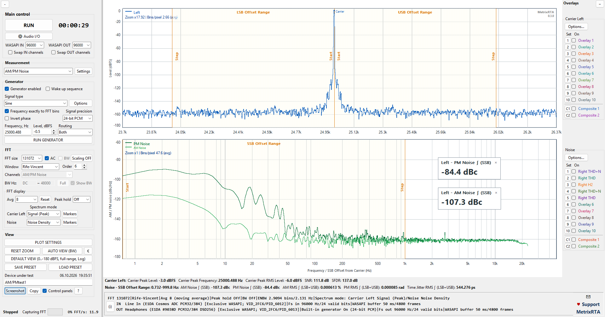
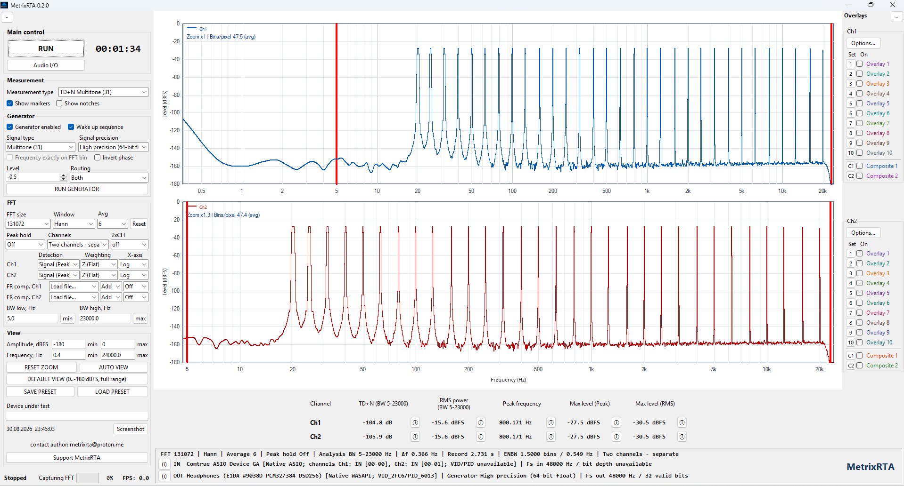
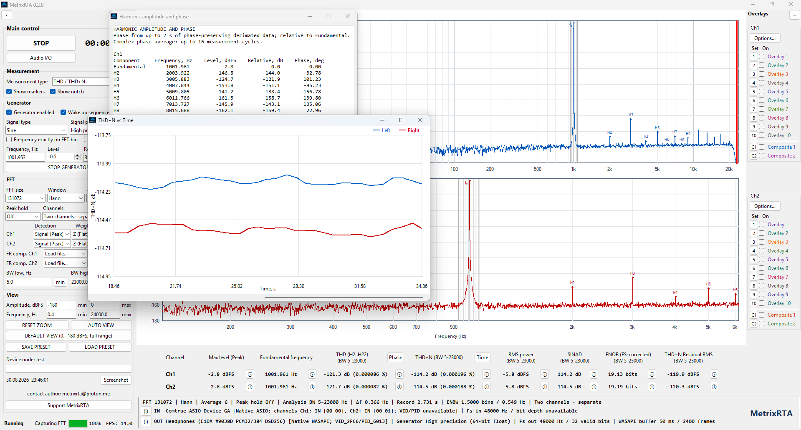
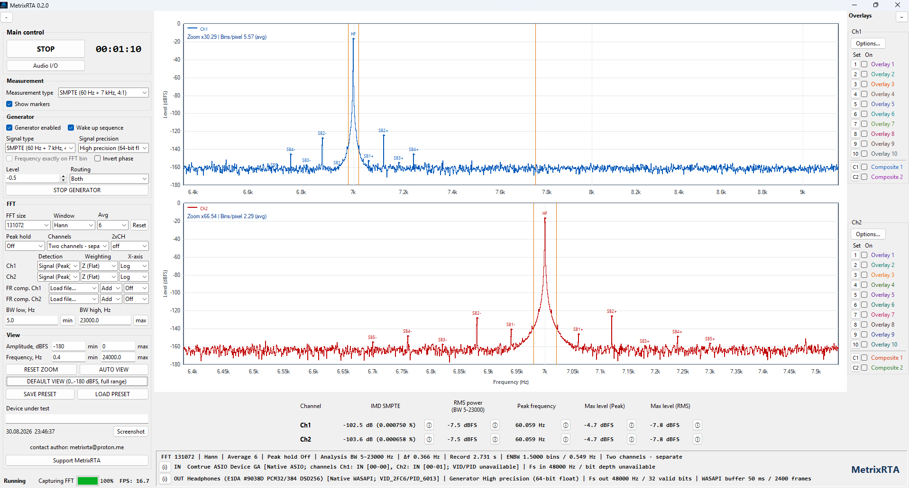
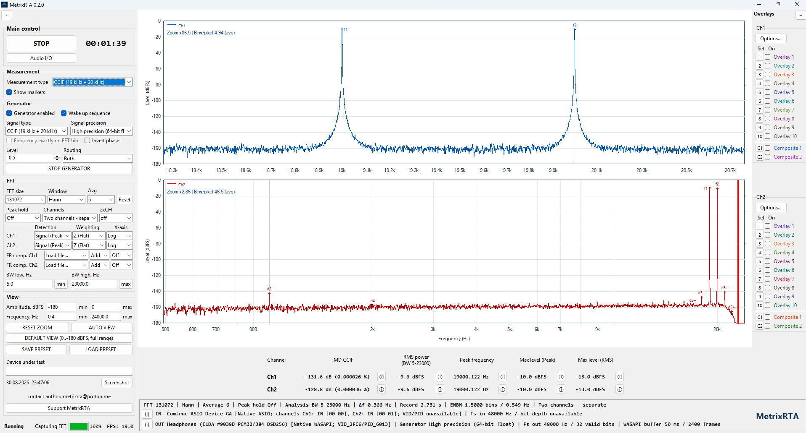

# MetrixRTA

**Real-time audio spectrum, distortion, and noise analysis for Windows.**

MetrixRTA combines an FFT analyzer, audio measurements, a test signal generator, automated Step Tests, and measurement history in one Windows application. It supports independent audio input and output devices, two-channel analysis, and detailed measurement results.

**Free to use · Closed source · Windows x64**

## Download

**[Current pre-release: MetrixRTA 0.4.0](https://github.com/MetrixRTA/MetrixRTA/releases/tag/v0.4.0)** · [All releases and release notes](https://github.com/MetrixRTA/MetrixRTA/releases)

Download the `.exe` and matching `.sha256` file from the release assets. MetrixRTA is under active development; features and behavior may change between pre-releases.

This public repository provides documentation, screenshots, and binary releases. The application source code is not published here. GitHub's automatic **Source code (zip)** and **Source code (tar.gz)** downloads are snapshots of this public repository, not application downloads.

## Features

### Spectrum and waveform analysis

- FFT sizes from **1,024 to 8,388,608 points**.
- Linear and logarithmic frequency scales, spectrum and noise-density displays, averaging, and Peak Hold.
- Rectangular, Hann, Blackman–Harris, Kaiser, Rife–Vincent, and Flat Top windows, including HFT70, HFT90D, and HFT116D variants.
- Single-channel, separate-channel, and overlaid two-channel views.
- Waveform display, including the input signal and distortion residual during supported measurements.
- Interactive scaling, coordinate cursors, text and arrow annotations, and day/night display modes.
- Saved spectrum overlays for comparing measurements, including overlay subtraction and averaging.

### Audio measurements

| Measurement | Capabilities |
| --- | --- |
| THD / THD+N | Harmonic distortion and distortion plus noise, with detailed results and harmonic analysis |
| CCIF / DFD / Generic IMD | Two-tone intermodulation analysis |
| SMPTE IMD | Intermodulation measurement using a 60 Hz + 7 kHz signal at a 4:1 ratio |
| IM3 asymmetry | Comparison of the upper and lower third-order intermodulation products |
| DIM30 / DIM100 | Dynamic intermodulation measurements |
| TD+N Multitone (31) | Distortion and noise analysis with a 31-tone signal |
| AM level | Amplitude-modulation level measurement |
| AM/PM noise | Amplitude and phase noise spectra, integrated noise, AM/PM RMS, and equivalent RMS time jitter |

Measurement Details explains supported calculations with formulas, intermediate values, and the measured values used in the result. Measurement bandwidth and available options depend on the selected mode.

### Two-channel and cross-correlation analysis

- **11 composite spectral modes:** channel addition and averaging; real transfer functions; cross spectra; complex transfer functions; coherence; and combined complex transfer/coherence views.
- Magnitude, phase, and coherence displays with spectral averaging and measurement overlays.
- Dual-channel cross-correlation for AM/PM noise analysis, with cross-spectrum averaging, continuous or fixed-count acquisition, selectable estimators, and estimated detection limits.

AM/PM cross-correlation can reduce uncorrelated measurement-channel noise. Its effectiveness depends on the independence of the two measurement channels; correlated noise is not rejected.

### Automated Step Tests

- Measurements **versus frequency** or **versus signal level**.
- THD/THD+N, IM3, CCIF, SMPTE, multitone TD+N, DIM30, and DIM100 test types.
- Configurable test ranges, point spacing, settling, and stability checks.
- Two-channel results, individual harmonic curves for THD tests, and interactive plots.
- Saved overlays with measurement metadata, plus results retained for review after a test finishes.

Open **Measurement → Step Tests…** to configure a test.

### Built-in signal generator

- Sine, square, triangle, white noise, and pink noise.
- Two-tone, CCIF, SMPTE, DIM30, DIM100, and AM level test signals.
- **31-tone multitone** with equal-amplitude and music-shaped spectral profiles.
- Sine sweep and dual-channel reference signals.
- Playback of **custom WAV files**.
- Configurable output level and channel routing, with frequency alignment and phase options for supported signals.

### Calibration and scaling

- Level offsets and normalization for relative dBr measurements.
- Frequency weighting: A, C, ITU-R 468, RIAA, and inverse RIAA.
- Frequency-response compensation using supported `.mic`, `.csv`, or `.ovl` files.
- Manual and measured-reference voltage calibration, with V, dBV, and dBu displays.
- Power displays derived from calibrated voltage and the specified load resistance, including W and dBm/dBW units.

### Measurement history and export

- Record measurement displays, numerical results, and settings in `.mtrx` history files.
- Browse saved measurements by device under test, measurement type, or date.
- Replay recorded measurements and review completed Step Tests.
- Inspect recorded settings and available audio-I/O diagnostics.
- Export numerical results to CSV and save or copy screenshots to the Windows clipboard.

History stores measurement data for review; it is not a raw-audio recording facility.

### Audio I/O and performance

- Native **WASAPI Exclusive** and **ASIO** audio I/O.
- Independent selection of input/output devices and sample rates.
- Sample rates up to **768 kHz**, where supported by the audio hardware and driver.
- Digital Loopback for working with generated signals without an external audio connection.
- Independent capture and generator controls.
- Audio I/O and spectrum processing/rendering run in separate processes to keep demanding analysis work independent of the main interface.

## System requirements

- **Windows 10 or Windows 11, x64**.
- A compatible WASAPI or ASIO audio device for external audio input/output.
- The manufacturer's ASIO driver when using ASIO.

Available sample rates, channel counts, and formats depend on your hardware and driver. Large FFT sizes and simultaneous analysis modes require more processing power and memory.

## Getting started

1. Download the Windows x64 `.exe` from a release and verify its SHA-256 checksum.
2. Launch MetrixRTA and select the input device, channels, and sample rate.
3. Select an output device if you want to use the built-in generator, or choose Digital Loopback to explore internally generated signals.
4. Choose the measurement, FFT size, window, and analysis bandwidth. Configure the generator if needed.
5. Start capture and, when needed, the generator. Use Measurement Details to inspect results, overlays to compare them, and History to record a session.

## Verify a download

Open a terminal in the folder containing the downloaded EXE. For the current 0.4.0 build:

**PowerShell:**

```powershell
Get-FileHash -LiteralPath '.\MetrixRTA_0.4.0_031677_x64.exe' -Algorithm SHA256
```

**Command Prompt (cmd.exe):**

```cmd
certutil -hashfile "MetrixRTA_0.4.0_031677_x64.exe" SHA256
```

Compare the resulting hash with the matching `.sha256` asset and the checksum on the release page. For another build, substitute its exact filename. Official binaries are distributed through [this repository's releases](https://github.com/MetrixRTA/MetrixRTA/releases).

## Documentation and feedback

- [Documentation](docs/).
- [Release notes](https://github.com/MetrixRTA/MetrixRTA/releases) describe changes for each published version.
- [GitHub Issues](https://github.com/MetrixRTA/MetrixRTA/issues) is the place for bug reports and feature requests.

For a bug report, include the version and executable filename, Windows version, audio device and driver, relevant measurement settings, and steps to reproduce. Screenshots and audio-I/O diagnostics can help explain the issue.

## Screenshots












## License and support

MetrixRTA is **free to use** and distributed as **closed-source software**. All rights reserved.

If you find it useful, you can support continued development through [Ko-fi](http://ko-fi.com/metrixrta/tip) or [Boosty](http://boosty.to/truerta/donate). Tips are entirely voluntary and do not unlock additional features.
